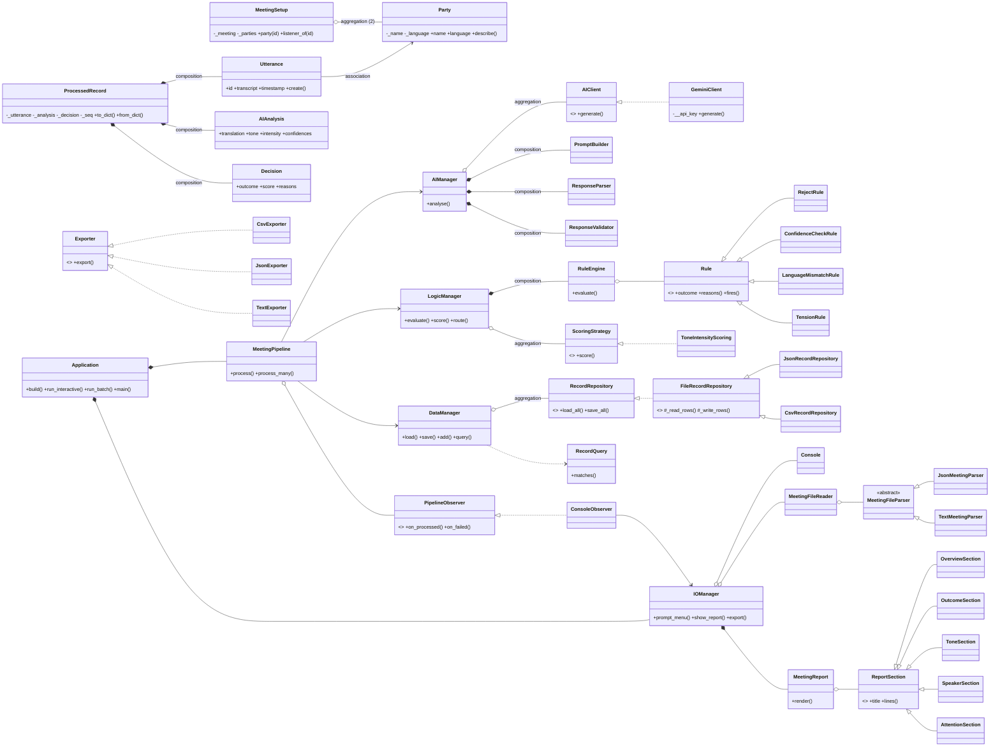
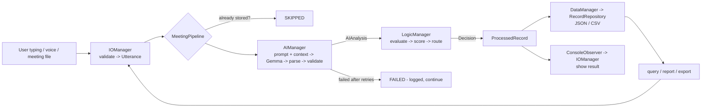
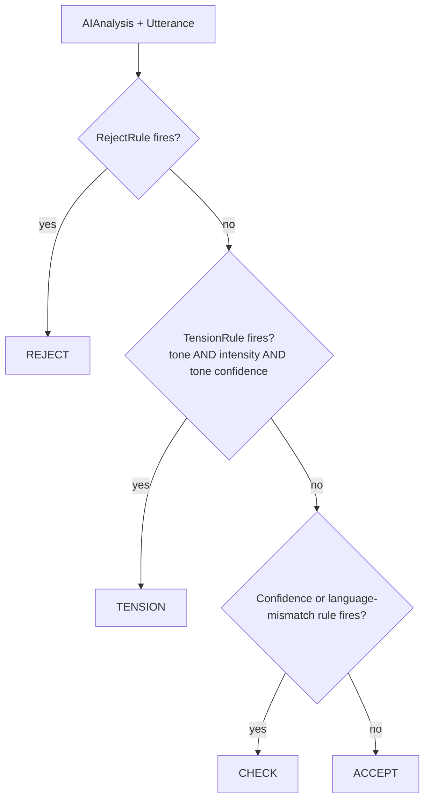
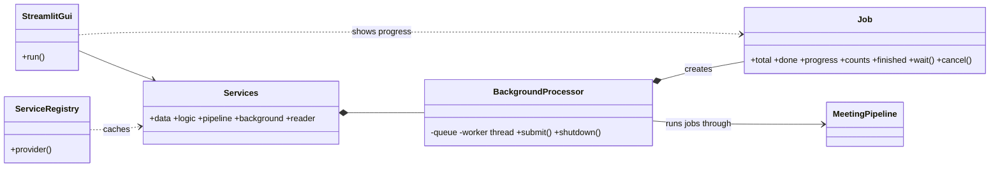
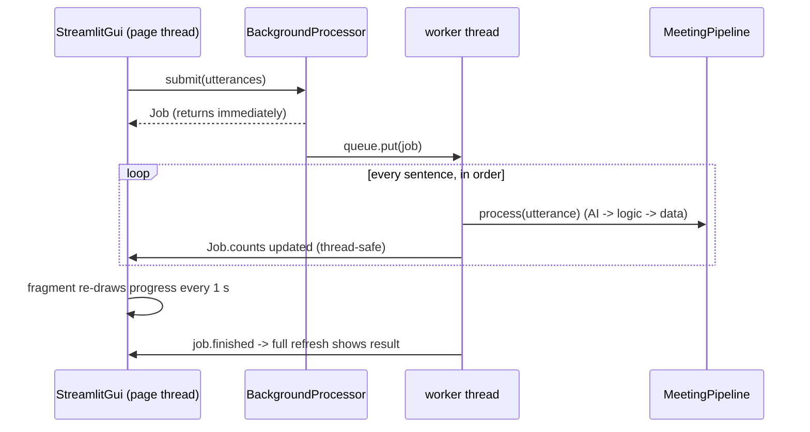
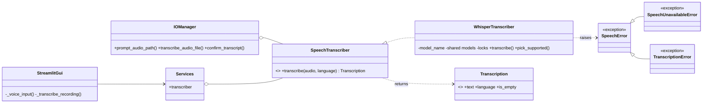
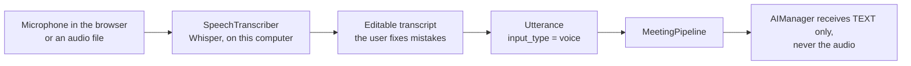

# Design diagrams (Mermaid)

GitHub renders these automatically. Export them as images for the engineering report.

## UML class diagram

## Data flow

## Routing rules

## Advanced deliverables: threading and GUI

## Speech-to-text (voice input)

